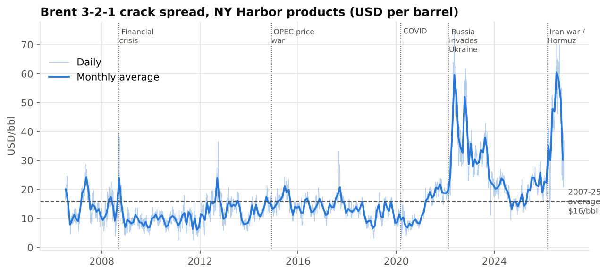

# Refinery Margins: Crack Spreads, Yield Flexibility and Hedging (2006–2026)

**Author:** Tanay Bachhawat, Chemical Engineering, University College London

A data project that brings together chemical engineering, commodity markets and data analytics. It answers three questions:

1. **What drives refinery margins?** 20 years of daily Brent, WTI, gasoline and diesel prices, turned into crack spreads with SQL.
2. **What is a refinery's ability to change its product slate worth?** A yield-based margin model of a diesel-oriented NW European refinery the size of Fawley (~270,000 bbl/day).
3. **Should a refiner hedge?** A backtest of six hedging strategies, comparing the risk each removes with what it costs.



---

## Key findings

| | |
|---|---|
| **Margins have shifted structurally** | The Brent 3-2-1 crack averaged **$15.7/bbl over 2007–2025** but **$40.5/bbl in Jan–Oct 2026**, higher even than 2022 ($37.1). July 2026 ($60.5) was the best month in the dataset. |
| **Diesel has driven the shift** | Since the US-Israeli war on Iran began on 28 Feb 2026 and shipping through the Strait of Hormuz was disrupted, the diesel crack has averaged **$72/bbl** against **$31/bbl** for gasoline. By October 2026 the gap was extreme: diesel **$84**, gasoline **$3.5**. The Middle East is a major exporter of diesel and jet fuel, so the disruption hit middle distillates hardest. |
| **Seasonality is real and predictable** | Gasoline cracks run about **$3/bbl above** their annual average in May (driving season) and nearly **$4 below** in December. Diesel peaks in **November** (heating demand). |
| **Volatility hit a record in 2026** | 60-day crack volatility peaked at **$82/bbl annualised** in 2026, against a 20-year median of $22. That is higher than in 2008 or 2022. |
| **Product flexibility pays** | A refinery that switches between max-diesel and max-gasoline mode each month (deciding on last month's prices, no hindsight) earns **+$0.36/bbl** on average, or about **$32m a year** at Fawley scale. Since 2022 that has doubled to **+$0.71/bbl (~$63m a year)**, and diesel mode was the better choice in 81% of months. |
| **Hedging buys certainty, not average margin** | A 50% hedge placed 3 months ahead **halves** how far the margin lands from what was visible when planning ($7.3 → $3.6/bbl), at an average cost of $0.29/bbl. It reduces overall volatility by only 10%, because a 3-month hedge cannot protect against multi-year regime shifts. |
| **Hedging is painful in a spike** | The 50% hedge would have **lost ~$246m in 2022** and **~$325m in 2026 (annualised)** for a Fawley-size refinery, then **gained ~$216m in 2023** when cracks fell back. |
| **Hedging the crack is not hedging the margin** | Part of a refinery's margin is tied to the **crude price level** (crude burned as fuel or lost, and low-value products sold below crude). A crack hedge leaves that exposure open: none of the hedges reduced the number of months with a negative modelled net margin, except the opportunistic one (43 vs 49). |

---

## How it works

```
FRED / EIA daily prices ──► SQLite (long table) ──► SQL views: $/bbl conversion, crack spreads, monthly averages
                                                    │
                     ┌──────────────────────────────┼──────────────────────────────┐
                     ▼                              ▼                              ▼
          Market analysis (SQL)          Refinery margin model (Python)   Hedging backtest (Python)
          regimes, seasonality,          yield slate × product prices     6 strategies, 2010–2026
          extremes, volatility           − crude − opex; mode switching
                     └──────────────────────────────┼──────────────────────────────┘
                                                    ▼
                         Charts (outputs/charts)  +  Tableau-ready CSVs (outputs/tableau)
```

### Data
Daily spot prices from the US Energy Information Administration (EIA), downloaded via FRED (St. Louis Fed). The data runs from July 2006 to 3 November 2026: **4,950 trading days** on which all four series have a price.

| Series | FRED code | Unit |
|---|---|---|
| Brent crude | `DCOILBRENTEU` | $/bbl |
| WTI crude (Cushing) | `DCOILWTICO` | $/bbl |
| Conventional gasoline, NY Harbor | `DGASNYH` | $/gal → ×42 to $/bbl |
| Ultra-low-sulphur diesel, NY Harbor | `DDFUELNYH` | $/gal → ×42 to $/bbl |

Data checks in `build_db.py` look for missing values, duplicate rows and non-positive prices. The one negative price, WTI at **−$36.98 on 20 April 2020**, is real (Cushing storage was nearly full) and is kept.

### Definitions
- **3-2-1 crack spread** = (2 × gasoline + 1 × diesel − 3 × crude) ÷ 3. This is roughly the gross margin from refining 3 barrels of crude into 2 of gasoline and 1 of diesel.
- **Single-product cracks** = product price − Brent.
- **Brent** is used as the main benchmark because the refinery being modelled is in NW Europe. NY Harbor product prices stand in for European ones; the US East Coast imports European gasoline, so the two markets are closely linked by arbitrage.

### Refinery margin model (`src/margin_model.py`)
Net margin = (yields × product prices) − crude cost − variable opex. Base case: 28% gasoline, 44% diesel/jet, 24% other products valued at 90% of Brent, 4% fuel and loss, $4/bbl opex. Max-diesel and max-gasoline modes move 4% of yield between gasoline and distillate. This is roughly what a refinery can do by changing distillation cut points and the severity of its FCC and hydrocracker.
> These parameters are **illustrative assumptions**, not ExxonMobil data. The model is built so they are easy to change.

### Hedging backtest (`src/hedge_backtest.py`)
Hedged margin = realised crack + h × (locked crack − realised crack). The six strategies:

| Strategy | Volatility (std, $/bbl) | Surprise vs 3 months earlier | Avg margin vs unhedged |
|---|---|---|---|
| Unhedged | 10.3 | 7.3 | – |
| 50% hedge, 3 months ahead | 9.2 | 3.6 (−50%) | −$0.29 |
| 50% layered (1/3 each month) | 9.5 | 4.9 (−33%) | −$0.17 |
| 50% annual budget hedge (set in December) | 7.3 | 5.8 (−21%) | −$2.15 |
| 100% hedge, 3 months ahead | 9.6 | 0.0 (−100%) | −$0.58 |
| Opportunistic (lock only when crack in top 30% of last 3 years) | 9.7 | 3.3 (−55%) | +$0.24 |

The annual budget hedge looks expensive partly because December is the **seasonal low** for gasoline cracks, so it locks in a weak price. A real forward curve would already price that seasonality in. That shows why seasonality matters when timing hedges.

### Limitations
- **No forward curves.** Free data has no history of crack spread futures, so the hedge locks in the spot crack at the time it is placed. In backwardated markets (2022, 2026), real forwards traded below spot, so this backtest overstates what a hedger could have locked in. The opportunistic strategy is the one most flattered by this.
- **US prices for a European refinery.** NY Harbor products and Brent crude are a proxy. ARA (Rotterdam) prices would be more accurate but are not freely available.
- **Simplified refinery.** The model has fixed yields, no crude slate optimisation, no product quality premiums, and no costs for carbon, freight or downtime.
- **2026 is a partial year** (January to October for monthly figures).

---

## Run it yourself
```bash
pip install -r requirements.txt
python run_all.py                 # rebuild from the included CSV
# or re-download fresh data:
export FRED_API_KEY=...           # free key from fred.stlouisfed.org
python run_all.py --fetch
```

## Project structure
```
├── data/raw/fred_prices_daily.csv   raw prices (long format)
├── sql/
│   ├── 01_schema_and_views.sql      tables, unit conversion, crack spread views
│   ├── 02_annual_summary.sql
│   ├── 03_seasonality.sql
│   ├── 04_extreme_months.sql
│   └── 05_regimes.sql               2008, 2014-16, 2020, 2022, 2026 compared
├── src/
│   ├── fetch_data.py                FRED API download
│   ├── build_db.py                  data checks + load into SQLite
│   ├── margin_model.py              yield-based refinery margin model
│   ├── hedge_backtest.py            hedging strategies + risk metrics
│   └── analysis.py                  runs everything, makes charts and CSVs
├── outputs/
│   ├── charts/                      8 PNG charts
│   ├── tableau/                     tidy CSVs for Tableau Public
│   └── key_results.json
└── run_all.py
```

## Sources
- Prices: U.S. Energy Information Administration, via FRED (Federal Reserve Bank of St. Louis).
- 2026 market context: EIA, *Crude oil and petroleum product prices increased sharply in the first quarter of 2026* (7 April 2026); Reuters oil price poll (30 October 2026).
- Fawley capacity (~270,000 bbl/day): public reporting on ExxonMobil Fawley.
